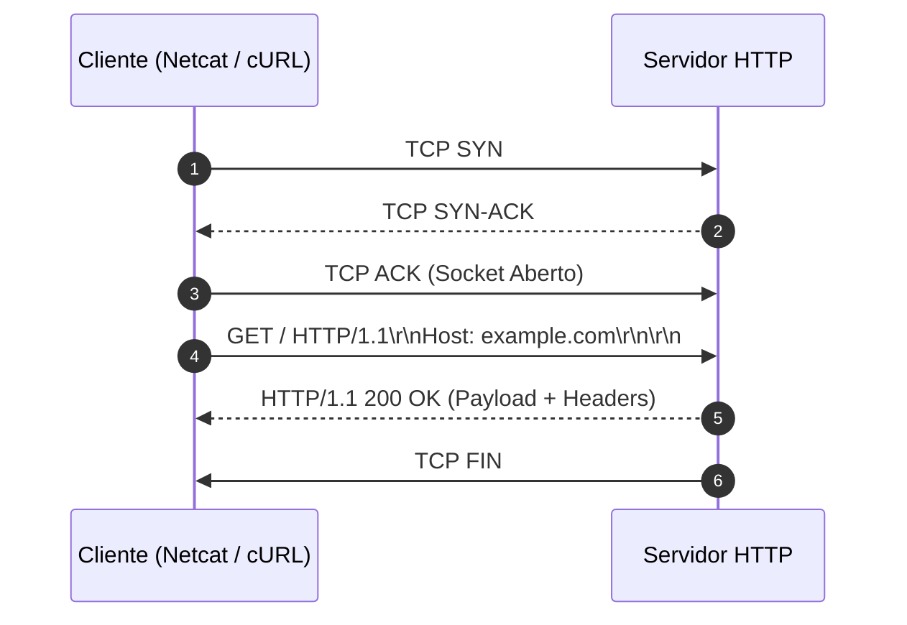

# Memória de Desenvolvimento — Semana 01: Protocolo HTTP & Sockets Bare-Metal
**Aluno:** Maria Paula Peixoto de Azevedo
**Matrícula:** 202411200339
**Curso:** Sistemas de Informação

---

## 1. Mapeamento da Camada de Transporte
Diagrama Mermaid demonstrando o ciclo de vida da requisição executada no laboratório:

---

## 2. Registro dos Experimentos de Laboratório

### Experimento 1: Netcat Nu & Falha 400 Bad Request
* **Comando Testado:** `nc -C example.com 80` sem o header `Host:`
* **Resultado:**
Ao enviar uma requisição HTTP/1.1 sem o cabeçalho Host, o servidor pode retornar o código 400 Bad Request, indicando que a requisição está incorreta.
Isso acontece porque o HTTP/1.1 exige o cabeçalho Host, que identifica o domínio solicitado. Esse campo é importante para o Virtual Hosting, pois permite que um único servidor hospede vários sites utilizando o mesmo endereço IP.
Sem essa informação, o servidor pode não conseguir identificar corretamente qual site o cliente deseja acessar.

### Experimento 2: Semântica dos Métodos HTTP
* **Análise dos Verbos:** Explique a diferença observada entre chamadas `GET`, `POST` e `OPTIONS`.

GET: utilizado para solicitar informações de um servidor, como páginas HTML ou dados de uma API.
POST: utilizado para enviar informações ao servidor, como dados de formulários ou cadastros.
OPTIONS: utilizado para consultar quais métodos e opções de comunicação estão disponíveis para determinado recurso.

* **Header Content-Length:** Como o tamanho do payload afeta a leitura no buffer do socket?
O cabeçalho Content-Length informa o tamanho do corpo da mensagem em bytes. Essa informação permite que o servidor saiba quantos bytes precisa ler do socket para receber o conteúdo completo.
Se o tamanho informado estiver incorreto, a leitura pode ficar incompleta ou o servidor pode aguardar dados adicionais, prejudicando o processamento da requisição.

### Experimento 3: URL, Query Strings & Percent-Encoding
* **URL Testada: (Passo 1)** curl -v http://httpbin.org/get?curso=Engenharia da Computacao
* **URL Testada: (Passo 2)** curl -v https://httpbin.org/get?curso=Engenharia%20da%20Computa%C3%A7%C3%A3o
* **O erro no Passo 1:** O que o terminal retornou ao tentar rodar a URL com espaços reais?
Ao executar o comando sem aspas, o terminal interpreta os espaços como separadores de argumentos. Assim, o cURL recebe uma URL incompleta e pode tentar interpretar as palavras restantes como outros endereços, produzindo erros de resolução de nomes ou de URL.

* **A função do `%20`:** Explique de forma simples por que somos obrigados a substituir espaços e caracteres especiais (como acentos) por códigos com `%` nas URLs.
O %20 representa um espaço dentro de uma URL. Esse processo é chamado de Percent-Encoding e permite representar caracteres que não podem ser utilizados diretamente em determinadas partes de um endereço.
Caracteres acentuados também podem ser codificados. Por exemplo, ç é representado por %C3%A7 em UTF-8.
Essa codificação garante que o endereço seja interpretado corretamente durante a comunicação entre cliente e servidor.

### Experimento 4: Negociação de Conteúdo & User-Agent
* **Análise:** Como o servidor reage ao receber diferentes cabeçalhos `Accept` e `User-Agent`?
O servidor pode modificar sua resposta de acordo com os cabeçalhos enviados pelo cliente.
O cabeçalho Accept informa quais formatos de conteúdo o cliente prefere receber, como text/html ou application/json. Dependendo da configuração, o servidor pode retornar o formato solicitado ou responder com o código 406 Not Acceptable, caso não consiga fornecer uma representação compatível.
Já o cabeçalho User-Agent identifica o software utilizado para realizar a requisição, como um navegador ou o cURL. O servidor pode utilizar essa informação para adaptar o conteúdo, registrar acessos ou aplicar determinadas regras.
Entretanto, nem todos os servidores alteram suas respostas com base nesses cabeçalhos.

### Experimento 5: Redirecionamentos & Cache Condicional
* **Redirecionamento (301):** Qual a diferença ao executar `curl -I` com e sem a flag `-L`?
Ao executar curl -I, o cliente solicita apenas os cabeçalhos da resposta HTTP, sem baixar o corpo do conteúdo.
Se o servidor retornar um redirecionamento 301 Moved Permanently, o cURL exibirá o código e o cabeçalho Location, indicando o novo endereço, mas não seguirá automaticamente o redirecionamento.
Ao utilizar curl -I -L, o cURL acompanha os redirecionamentos até alcançar o destino final, exibindo os cabeçalhos das respostas recebidas durante o processo.

* **Validação de Cache (304):** Explique como o header `If-None-Match` e a `ETag` evitam retransmissão de dados na rede.
A ETag funciona como um identificador de versão de determinado recurso.
Quando o cliente já possui uma cópia armazenada em cache, pode enviar o cabeçalho If-None-Match contendo a ETag recebida anteriormente.
Se o recurso não tiver sido modificado, o servidor poderá responder com 304 Not Modified, sem retransmitir o corpo do arquivo.
Isso reduz o consumo de banda, diminui a quantidade de dados transferidos e melhora o desempenho da comunicação.
---

## 3. Conclusão Técnica
  Compreender a transmissão de bytes e o funcionamento do protocolo HTTP é fundamental para entender como ocorre a comunicação entre clientes e servidores. 
O HTTP/1.1 utiliza uma estrutura textual para representar requisições, respostas e cabeçalhos, enquanto a sequência CRLF (\r\n) é utilizada para separar as linhas dessas mensagens. 
Embora os elementos básicos do protocolo sejam representados por caracteres ASCII, os conteúdos transmitidos também podem utilizar outras codificações, como UTF-8.
  Esse conhecimento é importante para o desenvolvimento de sistemas distribuídos e aplicações de alto desempenho, pois permite compreender o funcionamento dos sockets, identificar erros de comunicação e otimizar a transferência de informações. 
Além disso, o entendimento dos métodos HTTP, cabeçalhos, redirecionamentos e mecanismos de cache contribui para a construção de aplicações mais eficientes, confiáveis e escaláveis.
