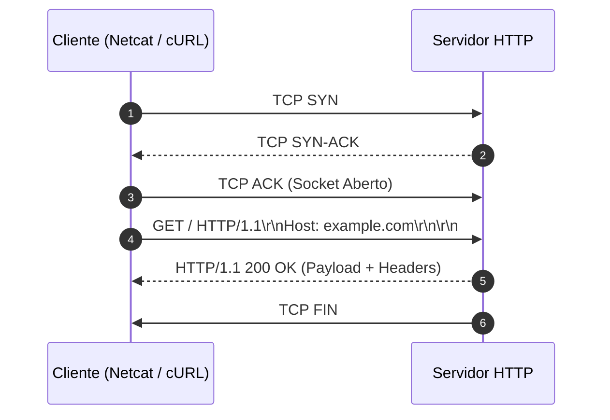

# Memória de Desenvolvimento — Semana 01: Protocolo HTTP & Sockets Bare-Metal
**Aluno:** Maria Paula Peixoto de Azevedo
**Matrícula:** 202411200339
**Curso:** Sistemas de Informação

---

## 1. Mapeamento da Camada de Transporte
Diagrama Mermaid demonstrando o ciclo de vida da requisição executada no laboratório:

---

## 2. Registro dos Experimentos de Laboratório

### Experimento 1: Netcat Nu & Falha 400 Bad Request
* **Comando Testado:** `nc -C example.com 80` sem o header `Host:`
* **Resultado:** O servidor pode responder com o status 400 Bad Request, sinalizando que a solicitação apresenta algum problema ou não contém os campos necessários. O cabeçalho Host é obrigatório no HTTP/1.1 porque indica o domínio que o cliente deseja acessar. Como diferentes sites podem estar hospedados no mesmo endereço IP, essa informação ajuda o servidor a direcionar a requisição para o site correto.

### Experimento 2: Semântica dos Métodos HTTP
* **Análise dos Verbos:** Explique a diferença observada entre chamadas `GET`, `POST` e `OPTIONS`. 
O método GET serve para buscar informações disponibilizadas pelo servidor. O POST permite encaminhar dados para serem processados, como informações de um cadastro. Por sua vez, o OPTIONS é utilizado para verificar quais métodos e recursos de comunicação estão disponíveis para determinado endereço.
* **Header Content-Length:** Como o tamanho do payload afeta a leitura no buffer do socket? O Content-Length especifica quantos bytes compõem o corpo da mensagem HTTP. Essa informação orienta a aplicação sobre a quantidade de dados que precisa receber ou processar. Caso o tamanho não seja respeitado ou a leitura seja interrompida antes do momento correto, a mensagem poderá ficar incompleta ou ser interpretada de maneira inadequada.

### Experimento 3: URL, Query Strings & Percent-Encoding
* **URL Testada: (Passo 1)** curl -v http://httpbin.org/get?curso=Engenharia da Computacao
* **URL Testada: (Passo 2)** curl -v https://httpbin.org/get?curso=Engenharia%20da%20Computa%C3%A7%C3%A3o
* **O erro no Passo 1:** O que o terminal retornou ao tentar rodar a URL com espaços reais? A execução apresentou uma mensagem de erro relacionada ao formato da URL. Isso ocorre porque os espaços podem ser interpretados como separadores de argumentos pelo terminal ou tornar o endereço inválido para o cURL. Dessa forma, a requisição não é enviada corretamente até que o endereço seja formatado de maneira apropriada.
* **A função do `%20`:** Explique de forma simples por que somos obrigados a substituir espaços e caracteres especiais (como acentos) por códigos com `%` nas URLs.
O %20 é a representação codificada de um espaço em uma URL. O percent-encoding permite transformar caracteres que podem causar problemas na interpretação do endereço em sequências padronizadas. Por exemplo, letras acentuadas também podem ser representadas por códigos específicos em UTF-8. Isso facilita a transmissão dos parâmetros e reduz erros durante a interpretação da URL.

### Experimento 4: Negociação de Conteúdo & User-Agent
* **Análise:** Como o servidor reage ao receber diferentes cabeçalhos `Accept` e `User-Agent`? O cabeçalho Accept apresenta os tipos de conteúdo que o cliente consegue receber, permitindo que o servidor escolha uma representação compatível, quando disponível. Já o User-Agent fornece informações sobre o programa que está realizando o acesso, como um navegador ou uma ferramenta de linha de comando. Esses cabeçalhos podem influenciar o tratamento da requisição, dependendo das regras implementadas pelo servidor.

### Experimento 5: Redirecionamentos & Cache Condicional
* **Redirecionamento (301):** Qual a diferença ao executar `curl -I` com e sem a flag `-L`? Ao utilizar curl -I sem -L, o cURL apresenta os cabeçalhos da resposta inicial, que pode informar um redirecionamento permanente com status 301. Quando a opção -L é acrescentada, a ferramenta acessa também o endereço indicado pelo redirecionamento, permitindo visualizar os cabeçalhos das respostas seguintes. A opção -I solicita os cabeçalhos, enquanto -L determina que os redirecionamentos sejam seguidos.

* **Validação de Cache (304):** Explique como o header `If-None-Match` e a `ETag` evitam retransmissão de dados na rede. A ETag funciona como um identificador relacionado à versão de um recurso armazenado no servidor. Quando o cliente deseja verificar se sua cópia em cache continua atualizada, envia esse identificador pelo cabeçalho If-None-Match. Se o recurso permanecer inalterado, o servidor poderá responder com 304 Not Modified, evitando o envio desnecessário do conteúdo novamente. Com isso, há redução do consumo de rede e maior eficiência na comunicação.

---

## 3. Conclusão Técnica
[Descreva em 1-2 parágrafos a importância de compreender a transmissão de bytes ASCII e a sintaxe CRLF na camada de aplicação para desenvolvimento de sistemas distribuídos e de alta performance.]
Conhecer a forma como os bytes são transmitidos na camada de aplicação é essencial para compreender a comunicação entre computadores e desenvolver sistemas mais confiáveis. No HTTP, as mensagens seguem uma estrutura definida, com cabeçalhos que descrevem a requisição ou resposta e um possível corpo contendo os dados. Dominar essa organização facilita a identificação de falhas e a implementação correta dos mecanismos de comunicação.

O CRLF, representado por \r\n, determina o encerramento das linhas dos cabeçalhos HTTP e participa da separação entre os cabeçalhos e o corpo da mensagem. Entender sua utilização, juntamente com o controle da quantidade de bytes transmitidos, ajuda a evitar erros de leitura e interpretação. Esses conhecimentos contribuem para criar aplicações distribuídas mais eficientes, compatíveis e capazes de lidar adequadamente com a comunicação pela rede.
