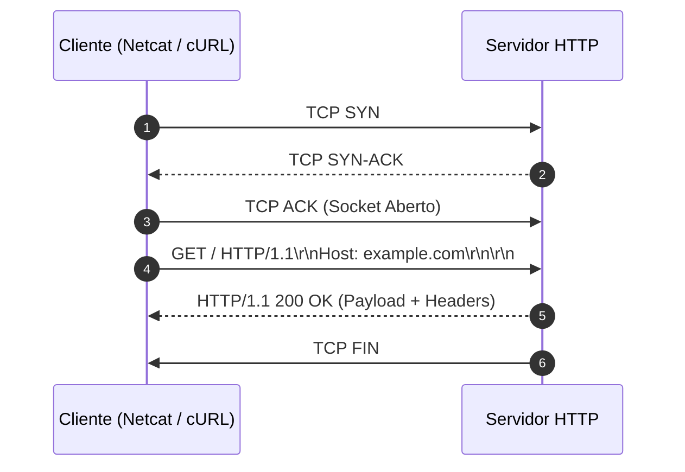

# Memória de Desenvolvimento — Semana 01: Protocolo HTTP & Sockets Bare-Metal
**Aluno:** [Seu Nome Completo]  
**Matrícula:** [Seu Número de Matrícula]  
**Curso:** Ciência / Engenharia da Computação  

---

## 1. Mapeamento da Camada de Transporte
Diagrama Mermaid demonstrando o ciclo de vida da requisição executada no laboratório:

---

## 2. Registro dos Experimentos de Laboratório

### Experimento 1: Netcat Nu & Falha 400 Bad Request
* **Comando Testado:** `nc -C example.com 80` sem o header `Host:`
* **Resultado:** [Descreva o código de status retornado e por que o Virtual Hosting exige o campo Host no HTTP/1.1]

### Experimento 2: Semântica dos Métodos HTTP
* **Análise dos Verbos:** Explique a diferença observada entre chamadas `GET`, `POST` e `OPTIONS`.
* **Header Content-Length:** Como o tamanho do payload afeta a leitura no buffer do socket?

### Experimento 3: URL, Query Strings & Percent-Encoding
* **URL Testada:** `https://httpbin.org/get?curso=Engenharia%20da%20Computa%C3%A7%C3%A3o`
* **Mapeamento Hex:** Qual o código Hex de `%20` (espaço) e `%C3%A7` (ç)?

### Experimento 4: Negociação de Conteúdo & User-Agent
* **Análise:** Como o servidor reage ao receber diferentes cabeçalhos `Accept` e `User-Agent`?

### Experimento 5: Redirecionamentos & Cache Condicional
* **Redirecionamento (301):** Qual a diferença ao executar `curl -I` com e sem a flag `-L`?
* **Validação de Cache (304):** Explique como o header `If-None-Match` e a `ETag` evitam retransmissão de dados na rede.

---

## 3. Conclusão Técnica
[Descreva em 1-2 parágrafos a importância de compreender a transmissão de bytes ASCII e a sintaxe CRLF na camada de aplicação para desenvolvimento de sistemas distribuídos e de alta performance.]
